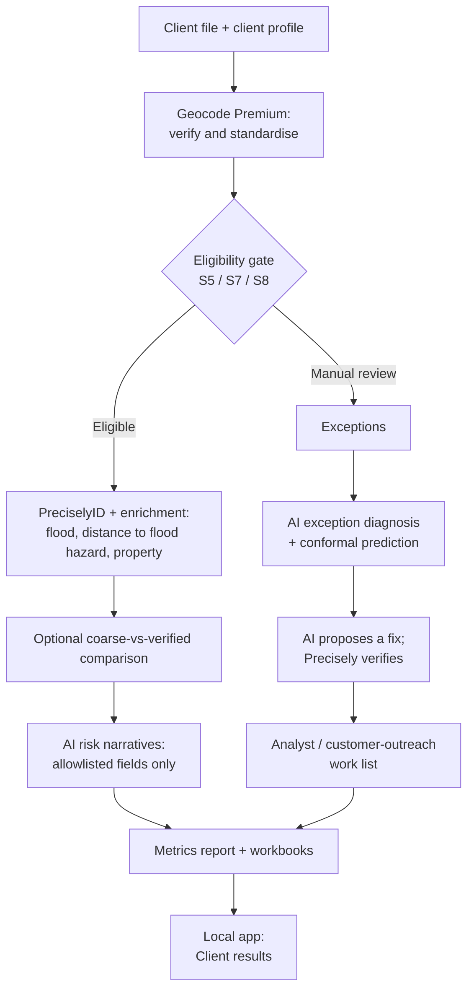

# Architecture

## Purpose and scope

This document describes the local address-processing pipeline and application. The implementation and setup are documented in the [README](../README.md). The business context and aggregate impact are described in the [business impact summary](BUSINESS_IMPACT.md).

## System overview

## Module map

| Module | Responsibility |
| --- | --- |
| `src/address_intelligence/client_profile.py` | Loads and validates per-client profile data and paths. |
| `src/address_intelligence/config.py` | Loads application settings and environment configuration. |
| `src/address_intelligence/credits.py` | Prices operations, enforces budget limits, and records credit ledger entries. |
| `src/address_intelligence/providers/precisely.py` | Sends Precisely API requests and normalizes provider responses. |
| `src/address_intelligence/pipeline.py` | Runs the staged geocoding, PreciselyID, enrichment, and comparison pipeline. |
| `src/address_intelligence/flood.py` | Normalizes and interprets flood-related provider data. |
| `src/address_intelligence/narrative.py` | Generates and evaluates evidence-grounded AI narratives. |
| `src/address_intelligence/remediation.py` | Diagnoses exceptions and produces calibrated cause classifications. |
| `src/address_intelligence/remediation_actions.py` | Produces and verifies proposed exception corrections. |
| `src/address_intelligence/metrics.py` | Builds aggregate before-and-after metrics and reports. |
| `src/address_intelligence/workbook.py` | Builds public and private Excel workbooks. |
| `src/address_intelligence/baseline.py` | Calculates baseline metrics from the input and reference data. |
| `src/address_intelligence/synthetic_data.py` | Generates synthetic policy records and their reference data. |
| `src/address_intelligence/onboarding.py` | Guesses column mappings and builds client profiles. |
| `src/address_intelligence/app_data.py` | Loads local client results and prepares app-facing data. |
| `src/address_intelligence/logging_setup.py` | Configures application logging. |
| `app/streamlit_app.py` | Defines the local app and its workflow tabs. |
| `app/ui.py` | Provides shared presentation components and styling. |

### Scripts

| Script | Responsibility |
| --- | --- |
| `scripts/run_pipeline.py` | Runs a selected pipeline stage in dry-run or approved execution mode. |
| `scripts/generate_narratives.py` | Generates AI narratives for a client profile. |
| `scripts/evaluate_narratives.py` | Evaluates narrative output and guardrail results. |
| `scripts/diagnose_exceptions.py` | Classifies exception causes and reports calibration availability. |
| `scripts/remediate_exceptions.py` | Suggests or verifies remediation actions for exceptions. |
| `scripts/metrics_report.py` | Writes aggregate metrics reports. |
| `scripts/build_workbook.py` | Builds client and public workbooks. |
| `scripts/estimate_cost.py` | Estimates the credit and list-price cost of a planned run. |
| `scripts/baseline_report.py` | Produces a baseline summary from reference data. |
| `scripts/generate_synthetic.py` | Generates the synthetic dataset. |
| `scripts/validate_streets.py` | Runs address validation on street anchors. |
| `scripts/smoke_test.py` | Runs the Precisely integration smoke test. |
| `scripts/compare_geocode_modes.py` | Compares supported geocoding modes. |

## Configuration and multi-client design

A client profile defines the input file and column mapping, eligibility codes, enrichment items, whether comparison and AI steps are enabled, output folders, and data-handling settings. All pipeline and reporting scripts accept `--profile <path>`. Each client's source data and generated profile belong under `data/clients/<folder>/`; generated results belong under `data/output/<folder>/`. Both directories are git-ignored, and profile path validation keeps client paths inside `data/`. The credit ledger is account-wide across clients.

Without reference data, the private workbook is still generated, but its accuracy section is omitted. AI exception diagnosis and remediation report “not available” until a labelled calibration sample exists.

## Cost and safety controls

Paid pipeline stages are dry-run by default. Execution requires `--execute` and typing `YES`; the budget gate and credit hard cap prevent spending beyond configured limits. A response cache makes eligible repeated requests free. The ledger records billed calls, zero-credit failures, and calls that returned no result. Precisely only charges calls that return a result.

## Data protection and licensing

Only address columns are sent to Precisely. Only allowlisted derived fields are sent to the AI; never addresses, coordinates, ZIP codes, PreciselyIDs, water-body names, or policy IDs. Privacy guards prevent row-level data from appearing in public reports and workbooks. Row-level outputs remain in git-ignored folders and are deleted within 30 days, consistent with the Precisely APIs Acceptable Use Policy, sections 4.1–4.2.

The app binds only to localhost and never calls Precisely or the AI. For real data, it hides table downloads.

## AI design

### Narratives

Narratives are checked for valid JSON, grounded numbers, allowed evidence fields, and prohibited decision language. Manual-review records receive deterministic templates, and records without supporting evidence abstain.

### Exception handling

**Layer 1, diagnosis:** the model samples each exception 5 times; split-conformal prediction, calibrated on labelled examples, forms a set of likely causes and supports routing. In the reference run, top-answer accuracy was 62/68 and test coverage was 32/34 at a 90% target.

**Layer 2, verified suggestions:** a fix is applied only when Geocode Premium confirms it; house numbers are never changed. In the reference run, 6/6 suggestions confirmed by Precisely were correct, with 0 incorrect.

## Testing strategy

Unit tests use temporary folders and a temporary credit ledger. After each change to the pipeline, a regression check confirmed the same planned requests as the code before the multi-client work and identical reports. The new-client live end-to-end test is described in the [README](../README.md).

## Key design decisions

- **Geocode Premium for verification:** in testing, Address Verification Premium returned Status F, “Address Not Found,” for defective input and still consumed a credit; Geocode Premium corrected defective input and returned a precision code used as the eligibility gate (see [Project Plan, section 7](PROJECT_PLAN.md)).
- **Enrich only S5/S7/S8:** flood data bought for a street- or ZIP-level location can give the wrong flood zone. The coarse-vs-verified comparison changed the flood-risk tier for 14 of 39 records, and enrichment costs about 8 credits per record, so it is only bought for building-level matches.
- **Paid execution only from the command line:** provides budget control and human approval for anything that spends money, and keeps API keys out of web pages.
- **Aggregates only in the public repository:** row-level Precisely results may not be publicly displayed or stored beyond temporary use (Acceptable Use Policy, sections 4.1–4.2); full records are shared privately.
- **Groq for the AI step:** meets the free-tier requirement, its services agreement prohibits training on inputs and outputs, and Zero Data Retention is enabled. Gemini's free tier was excluded because prompts may be used to improve products.
- **Local-only app:** the app can show row-level Precisely results, so it binds to localhost and is never deployed; it never reads API keys or calls Precisely or the AI (enforced by a test).

## Future work

The README roadmap lists verified AI fix suggestions for new clients before calibration, client labelling to enable calibrated confidence and automatic routing, per-client ledger attribution, an approved app run button with a budget check and vault-held keys, client-environment deployment, full-book performance testing, and an enterprise agreement and data processing addendum with the AI provider.

Calibrated confidence needs the client's own labels because conformal prediction assumes calibration data comes from the same distribution as new data. Fix suggestions can be offered before calibration because Precisely verifies each suggestion; those records remain routed to an analyst.

The [README roadmap](../README.md#roadmap) describes the learning loop's value for new clients.

### Learning loop (technical outline)

1. Add an uncalibrated mode to remediation: request a fix and Precisely verification for every exception, skip confidence and routing, route all exceptions to analyst review, and keep house numbers protected.
2. Add a "True cause" column to the work list and app, saved per client in `data/clients/<folder>/labels.csv`.
3. Add a readiness check that runs the existing split-conformal calibration on the client's labels once at least 30 exist, reusing `evaluation.ground_truth_path`.
4. Mark the client as calibrated in the profile so the existing full process runs.

Re-calibrate periodically as client data changes.

## Deployment

The onboarding, pre-flight and cost tabs are pre-sales tools for a Solutions Architect. In production, the Client results view (summary for leadership, work list for operations) and the paid pipeline run in the client's own environment, behind approval, with API keys in a secrets vault.
