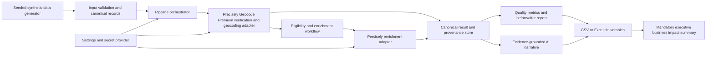

# Address Intelligence Platform: Project Plan

## 1. Executive summary and solution vision

Build a laptop-runnable Python prototype that demonstrates, on a controlled
synthetic insurance-policyholder dataset, how address verification,
geocoding, location enrichment, and one focused AI workflow can turn noisy
address records into evidence-backed underwriting context.

The prototype will prioritize a reproducible end-to-end demonstration and
clear customer-facing communication through the required business impact
summary over production-scale infrastructure. A small reusable pipeline will
isolate provider integrations from data processing and insurance-specific
decision rules. Actual Precisely-derived results will be distinguishable from
synthetic fixtures or simulated fallbacks. Metrics will describe the prototype
dataset only; any enterprise-scale financial impact will be explicitly framed
as an assumption or scenario, not as measured savings.

The fictional carrier has 300k+ policyholder records, but the assignment
requires a 200–500-record synthetic demonstration. The prototype will not
claim that a small synthetic sample proves results for the carrier's full
portfolio.

### Classification used in this plan

- **Explicit requirement:** stated in the candidate assignment.
- **Recommended decision:** an implementation choice proposed here to meet
  the assignment with appropriate safety and proportionate complexity.
- **Optional enhancement:** useful if time and access permit, but not needed
  for the core submission.

## 2. Assignment requirements traceability

| ID | Assignment requirement / update | Planned evidence / acceptance evidence |
|---|---|---|
| R1 | Generate 200–500 synthetic policyholder records with realistic address noise: misspellings/transpositions, missing unit numbers, ZIP/city mismatches, and outdated or non-existent addresses. Document how errors were introduced and the intentionally dirty percentage. | Reproducible generator, documented seed and per-error counts/rates, and a CSV with 200–500 rows. Synthetic identities and addresses are not represented as real policyholders. |
| R2 | Use Precisely APIs for address verification/standardization, geocoding, and geocoding with PreciselyID for persistent location linking. | Provider adapter and run artifacts using verified API capabilities; document API access and actual results. Do not assert PreciselyID availability/semantics until confirmed in current documentation and the account. |
| R3 | Produce before/after comparison including match rates, standardization improvements, and coordinate coverage. | Reproducible summary metrics with explicit denominators, missing/failure handling, and before/after outputs. |
| R4 | Append 3–5 relevant location enrichment attributes to validated records using Precisely APIs; explain why selected and what business decision they enable. | Attribute selection supported by verified product, field, and account-access documentation; enriched output and field provenance. |
| R5 | Implement one functional, focused AI step using a free-tier LLM option or local model; depth over breadth. | A tested AI workflow on actual or clearly labelled fixture enrichment data, with structured output and evidence-grounding checks. |
| R6 | Write a one-page VP of Operations business impact summary that communicates the business problem, quantifies two relevant risks in cost or revenue terms, explains how the proposed solution mitigates them, and explains the incremental value of AI beyond enrichment. | `docs/BUSINESS_IMPACT.md` with all financial inputs labelled as measured, sourced, or assumed; optional PDF export. |
| R7 | Everything runs locally on a laptop using free-tier services; no cloud infrastructure required. | Reproducible local setup and run instructions; no AWS, Azure, or GCP dependency. |
| R8 | Precisely free trial is described as 2,500 credits valid for 30 days; plan use and do not exhaust credits during exploration. | Written budget gate, measured/verified credit assumptions before calls, and a conservative execution plan. |
| R9 | Deliver a public GitHub repository containing runnable commented code or notebook, README with setup, `.env` key structure and sample outputs; before/after CSV or Excel workbook (`reports/before_after_workbook.xlsx`) with summary stats; and the one-page impact summary. | Repository contents and final checklist. |

### Explicit requirements versus scope boundaries

- The fictional carrier's scale and pain points (risk-zone assignment,
  misrouted claims, compliance exposure, and data not ready for AI
  underwriting) are the business scenario, not measured facts about a real
  customer.
- The assignment calls for a functional prototype. It does not require
  production deployment, enterprise-scale processing, automated underwriting
  decisions, a web UI, or a distributed system.
- A public repository is an explicit submission requirement.

### Mandatory and optional deliverables

**Mandatory:** a working, locally runnable prototype using 200–500 synthetic
policyholder records; verified Precisely address validation/standardization,
geocoding and PreciselyID mapping where supported and available; 3–5 verified
location enrichment attributes subject to actual product access and
documented API capabilities; one functional, evidence-grounded AI workflow;
before/after data, metrics, and documented results; a README covering setup,
configuration, and sample outputs; and the one-page business impact summary.
These artifacts are to be submitted in a public GitHub repository.

**Optional enhancements:** only those listed in Section 20; they do not
replace or delay mandatory deliverables.

## 3. Functional and non-functional requirements

### Target geography

**Recommended decision:** United States addresses only. This focuses the
prototype on standardized US hazard data and offers the best chance of
meaningful API matches. Phase 0 must confirm that US products and selected
attributes are enabled for the account before implementation or API use.

### Functional requirements

1. Generate a deterministic synthetic dataset with 200–500 rows and known
   injected defects.
2. Validate input structure and preserve an immutable copy of each raw
   address.
3. Use Geocode Premium as the sole Precisely verification/standardization and
   geocoding step after documentation, account access, and credit budget are
   verified. Address Verification Premium was tested in Phase 0 but is not
   used in the full run because it returned Status F “Address Not Found” for
   defective input and still consumed 1 credit.
4. Persist the provider's PreciselyID when the verified API operation returns
   one, retaining it as a provider-returned identifier rather than inventing
   or deriving one.
5. Apply a configurable enrichment selection to records that meet the
   documented validation/eligibility policy.
6. Produce row-level raw, standardized, geocoded, enriched, and processing
   status data, plus before/after quality metrics.
7. Generate one evidence-grounded, concise risk narrative or equivalent
   focused AI result, with explicit abstention when evidence is missing or
   contradictory.
8. Produce sample artifacts and a non-technical business impact summary.

### Non-functional requirements

- **Laptop-first:** local execution; free-tier services only for the prototype.
- **Reproducible:** pinned/declared dependencies, deterministic synthetic
  generation, documented commands and configuration.
- **Safe:** synthetic data only for external API/LLM calls; secrets kept out of
  source control; no unsupported underwriting or risk assertions.
- **Observable:** structured, actionable progress and errors without logging
  API credentials or unnecessary address/identity data.
- **Resilient:** timeouts, bounded retries for transient errors, explicit
  record-level partial-failure status, and a no-silent-fallback policy.
- **Maintainable:** typed contracts and small modules; provider-specific
  details isolated from reusable orchestration and scenario rules.
- **Testable offline:** unit and fixture-based tests do not require API
  credentials, network access, or LLM calls.
- **Proportionate:** no database, queue, cloud deployment, agent framework,
  or UI unless a later demonstrated need justifies it.

## 4. Proposed architecture and component responsibilities

### Architecture diagram



### Components

| Component | Responsibility |
|---|---|
| Synthetic data | Generate controlled, reproducible records and defect labels/ground truth for evaluating the demonstration. |
| Canonical data contracts | Define provider-independent input, normalized address, geocode, enrichment, status, and provenance shapes. Keep raw provider payloads out of general business logic. |
| Orchestrator | Execute ordered stages, enforce eligibility and configuration, manage per-record status, and summarize partial failures. |
| Precisely adapters | Own authentication, verified request/response mappings, timeouts, rate-limit behavior, and provider error translation. Exact API details remain gated on official documentation and account verification. |
| Enrichment workflow | Select requested fields and decide which successfully processed records are eligible; do not infer missing values. |
| Business rules | Express scenario-specific review flags or simple evidence-based rules separately from reusable address processing. No automated premium or coverage decisions. |
| AI workflow | Produce a short evidence-grounded explanation from explicitly supplied, available fields; separate model-generated text from authoritative source data. |
| Metrics/reporting | Calculate defined quality measures and export row-level results and aggregate summaries with provenance. |
| Configuration and logging | Load non-secret settings from configuration and secrets from environment; emit useful stage, timing, count, and error information. |

**Decision: deterministic orchestration, not an autonomous agent
(recommended):** the assignment needs a repeatable, auditable pipeline and one
focused AI step. A deterministic orchestrator is easier to budget, test,
explain, and reproduce than an autonomous agent. The trade-off is less
open-ended behavior, which is appropriate for a constrained customer demo.

**Decision: provider adapters and canonical contracts (recommended):**
isolate Precisely-specific request/response details so other scenarios or
providers do not require rewriting core processing. The trade-off is a small
amount of interface/mapping code; avoid a generalized plugin framework until
there is a second concrete implementation.

**Decision: local files, no database (recommended):** CSV/JSON artifacts are
sufficient for a 200–500-row laptop demo and directly meet the assignment's
output needs. The trade-off is that this is not a concurrent, durable,
production data platform.

## 5. Data flow: raw input to analyzed output

1. Generate seeded synthetic identities/records and retain defect labels and
   intended clean reference values separately from the API input.
2. Validate required columns, unique record IDs, address field types, and
   row count. Fail clearly on malformed input; do not silently drop records.
3. Create a canonical input record containing synthetic record ID and raw
   address components. Preserve the raw fields unchanged.
4. Use Geocode Premium for address verification/standardization and geocoding.
   Record returned standardized components, coordinates, and quality/status
   metadata only when present in the verified response mapping.
5. Preserve PreciselyID only where actually returned and supported.
6. Enrich only records with precisionCode S5, S7, or S8. Route other
   precisionCode results (for example S4, Z*, G*, or S0) to manual review and
   record the reason.
7. Record source, stage status, timestamps, and synthetic/API/simulated
   provenance for each output value. Missing and failed values remain missing
   with an explicit reason/status; never substitute invented values.
8. Compute quality metrics from the input, intended synthetic ground truth,
   and actual pipeline results using declared denominators.
9. Run the focused AI workflow only on an allowlisted set of available
   enrichment/geocoding fields. Store generated narrative separately from
   source facts.
10. Export row-level before/after results and aggregate summary; prepare the
    mandatory business impact summary from measured results plus explicitly
    labelled assumptions.

## 6. Proposed repository and module structure

```text
address-intelligence-platform/
├── README.md
├── pyproject.toml
├── .env.example                   # names/placeholders only; never credentials
├── .gitignore
├── config/
│   ├── client_profile.yaml        # client-specific columns, attributes, rules
│   └── examples/                  # example profiles
├── app/
│   ├── streamlit_app.py
│   ├── ui.py
│   └── demo_data/
├── .streamlit/
│   └── config.toml
├── src/
│   └── address_intelligence/
│       ├── client_profile.py
│       ├── config.py
│       ├── credits.py
│       ├── providers/precisely.py
│       ├── pipeline.py
│       ├── flood.py
│       ├── narrative.py
│       ├── remediation.py
│       ├── remediation_actions.py
│       ├── metrics.py
│       ├── workbook.py
│       ├── baseline.py
│       ├── synthetic_data.py
│       ├── onboarding.py
│       ├── app_data.py
│       └── logging_setup.py
├── data/
│   ├── input/                     # synthetic input only
│   ├── clients/                    # git-ignored client input and profiles
│   └── output/                     # git-ignored per-client outputs
├── scripts/
├── reports/                        # baseline, narrative, and remediation summaries
├── tests/
│   ├── unit/
│   ├── fixtures/
├── docs/
│   ├── PROJECT_PLAN.md
│   ├── ARCHITECTURE.md
│   └── BUSINESS_IMPACT.md
└── main.py                         # local configuration check
```

The implemented repository structure is shown above. The earlier proposed
`models.py`, `reporting.py`, `providers/llm.py`, `workflows/`, and `insurance/`
modules were not needed; their responsibilities are handled by the listed
modules.
Prefer a small runnable package over a notebook-only design because reusable
interfaces and repeatable tests matter; optionally add a notebook only if it
materially improves the live demonstration.

### Reusability: client profile

`config/client_profile.yaml` drives both the CLI pipeline and the app: input
column mapping, selected enrichment attributes and credit cost, eligibility
rules, AI steps on/off, conformal target, and data-handling rules. **New client
= new profile + their CSV.**

## 7. API dependencies and verification steps

Precisely APIs are explicitly required for address validation/standardization,
geocoding, and enrichment. Geocode Premium supplies the full-run
verification/standardization and geocoding step. Address Verification Premium
was tested in Phase 0 but is excluded from the full run because it returned
Status F “Address Not Found” for defective input and still consumed 1 credit.
Use verified API facts recorded in `docs/API_DISCOVERY.md`; do not infer
undocumented endpoint paths, authentication flows, request/response fields,
SDK support, pricing, or per-operation credit use. Account-specific product and
attribute access remains subject to confirmation.

Before implementation or any API call:

1. Confirm access to the Precisely developer account and the stated trial,
   including current expiration date, available credits, and terms.
2. Locate current official documentation for address verification,
   standardization, geocoding, PreciselyID, and candidate enrichment
   products/attributes. Confirm product availability for this account and
   intended geography.
3. Confirm authentication method, credential scopes, base URL/environment,
   request/response examples, batch support, limits, timeout guidance, error
   codes, and rate-limit/`Retry-After` behavior.
4. Confirm how credits are counted for each operation, whether failed,
   repeated, batched, or enrichment requests consume credits, and how to
   monitor remaining credits. Do not infer this from request count.
5. Verify the supported workflow for linking standardization, geocoding, and
   PreciselyID. Map only fields actually documented and returned.
6. Verify attribute definitions, units/categories, data freshness/coverage,
   interpretation constraints, licensing, and whether values are available
   from the granted account.
7. Check whether the APIs permit synthetic test addresses and whether any
   restrictions apply. Do not send real policyholder data.
8. Record links, access outcome, date checked, and unresolved questions in
   implementation documentation; redact credentials and account identifiers.

**Decision: documentation-first integration (recommended):** avoid guessed
endpoints and speculative SDK use. The trade-off is that the provider adapter
cannot be finalized until access is confirmed; this prevents wasted trial
credits and incorrect claims.

### Transparent fallback

If credentials, product access, an attribute, or an API operation is
unavailable, the offline pipeline may use deterministic fixtures for
development and tests. Every fixture/simulated field must carry provenance
such as `synthetic_fixture` or `simulated`, be described in the README and
outputs, and never be presented as an actual Precisely result. The final
submission must disclose any unmet required API capability rather than claim
the end-to-end API requirement has been satisfied.

## 8. Data model and proposed output schemas

The canonical model is internal and provider-independent. Exact provider
fields are mapped only after official schema verification.

### Proposed input columns

- `record_id`: synthetic stable identifier; no real person identifier.
- `raw_address_line_1`, `raw_address_line_2`, `raw_city`,
  `raw_state`, `raw_postal_code`, `raw_country`.
- `injected_error_types`: generator-side evaluation label(s), not sent to
  provider unless a specifically justified experiment requires it.
- `expected_reference_id` or equivalent generator-side clean reference
  linkage, stored separately from provider output.

### Proposed result columns

- Original raw address columns (immutable).
- `standardized_*`: canonical address components actually returned.
- `verification_status`, `geocode_status`, `processing_status`, and
  explicit error category/message safe for output.
- `latitude`, `longitude`, coordinate/reference metadata only if documented
  and returned.
- `precisely_id`: only the provider-returned PreciselyID, if available.
- `enrichment_*`: one column per selected and verified attribute, with
  documented units/categories.
- `ai_narrative`, `ai_status`, and evidence/source references or field list.
- Provenance/status per stage and attribute, e.g. actual API, synthetic
  fixture, simulated, unavailable, or failed.

### Proposed summary outputs

- Row counts and denominators at each stage.
- Verification/match rate as defined from documented API status semantics.
- Standardization improvement measured against controlled injected errors
  and/or an explicit component comparison rule.
- Coordinate coverage and geocode success rate.
- PreciselyID coverage, if the verified API returns it.
- Enrichment completion by selected attribute and eligibility denominator.
- AI completion/abstention/error counts.
- API operation counts and known/verified credit use, where available.

Prefer a CSV with one record per row plus a separate summary CSV/JSON. An Excel
workbook with summary and detail tabs is also compatible with the assignment,
but adds a dependency and should be selected only if it improves the
executive review. Do not write unverified provider raw payloads into
distributable sample output.

## 9. Synthetic dataset strategy and controlled data-quality errors

Generate 200–500 records with deterministic seed and documented construction
rules. Keep a clean reference address and injected-error labels for evaluation
separate from the address submitted to APIs.

**Recommended strategy:** use synthetic person/policy identifiers and
synthetic policy context, while anchoring address examples to a small,
documented set of legitimate, non-residential/publicly usable test locations
or another source approved for API testing. Apply controlled perturbations to
those locations. This is more likely to produce meaningful API matches than
fully fictional addresses while avoiding real policyholder PII. Confirm that
the source addresses are permitted by provider terms. Do not imply those
locations belong to policyholders.

If appropriate test locations cannot be sourced or API terms are unclear,
use generated addresses for offline tests and clearly explain that API
resolution may be unavailable; do not fabricate API success.

Proposed defect categories directly follow the assignment:

- Character misspellings/transpositions in street names or suffixes.
- Missing apartment/suite values for selected multi-unit cases.
- Deliberate city/postal-code inconsistency.
- Outdated or non-existent address cases, labelled as intentionally
unresolvable where known.

Set and document an overall dirty-record percentage and per-category
percentages before generation; choose a reproducible distribution that
includes clean controls. Track overlapping defects explicitly so category
counts do not incorrectly sum to unique dirty records. Report actual generated
counts, not just target percentages.

## 10. Precisely API credit-budget strategy

The account began with 2,500 trial credits. The Phase 0 smoke test used 13.81
credits, and the ledger matched the portal dashboard. Address Verification is
not used in the full run: it returned Status F “Address Not Found” for the
defective smoke-test input and still consumed 1 credit.

1. Inventory required operations and record verified credit costs, batching
   behavior, and retry/failure billing rules from official docs/account
   visibility.
2. Estimate cost as the sum of operation-specific credits for the planned
   records, accounting for eligibility, retries, and any separate
   validation/geocoding/enrichment operations. Do not assume one request is
   one credit or that batching reduces credits.
3. Set a hard run limit below available credits. **Approved hard cap:** 2,150
   credits, retaining approximately
   14% (350 credits) from the starting balance; the actual smoke-test
   consumption is included in the Phase 0 budget.
4. Prefer one small, representative smoke test after budget calculation,
   then inspect result quality and actual balance before the full run.
5. Use deterministic inputs and persist completed stage outputs so a failed
   later stage does not require repeating successful operations. Re-run only
   records/stages that need it where provider semantics permit.
6. Limit enrichment calls to records eligible under documented rules and
   only to selected attributes/products. Confirm whether attributes are
   separately charged. For the coarse-versus-verified comparison, budget
   Geocode Basic (0.1 credit) and a flood call (5 credits) at the coarse point
   for each comparison record, in addition to the verified-location enrichment.
7. Gate execution on an operator-configured maximum and display a clear
   estimate/confirmation before calls. Stop on unexpected credit accounting
   or rate-limit/error patterns; do not blindly retry.
8. If verified costs cannot fit the 200-record minimum/API scope within the
   budget, pause and disclose the constraint. Do not silently downgrade an
   API-required stage or represent fixtures as actual results.

The reserve percentage reflects the owner-approved hard cap, not a Precisely
billing rule.

## 11. Enrichment selection criteria and access dependencies

Select exactly 3–5 attributes only after confirming current products, access,
coverage, semantics, terms, and credit accounting. Candidate themes from the
assignment include:

- Flood/natural-hazard zone or exposure indicator.
- Property type/building characteristics.
- Distance or proximity to fire station/emergency services.
- Neighborhood demographics.

**Recommended selection principle:** prioritize attributes with a clear
underwriting or claims-service decision, interpretable coverage, reliable
provenance, and demonstrated account availability. Prefer hazard and
property/emergency-response context over neighborhood demographics for this
prototype. Demographic variables can introduce fairness, legal, and
proxy-discrimination concerns in insurance decisions; do not use them for
individual risk scoring or pricing absent explicit business/legal approval
and a defensible governance basis.

For each selected attribute, document: exact verified field/product name,
definition, units/categories, geography and freshness, missingness, stage
eligibility, API source/date, credit impact, intended business question, and
interpretation limitations. Do not infer or fabricate an attribute when it
is missing. If fewer than three suitable attributes are accessible, document
the unmet requirement and ask for a decision on an authorized alternative;
do not rename unrelated data to make the count appear satisfied.

## 12. AI workflow design, inputs, outputs, guardrails, and evaluation

### Recommended workflow: evidence-grounded underwriter risk narrative

This is one focused AI capability, not an autonomous agent. Given a single
synthetic record's verified geocoding and available, allowlisted enrichment
attributes, generate a two- to four-sentence plain-English summary for an
underwriter. Code computes missing-data disclosure and appends it after model
guardrails pass. It must not decide price, eligibility, claims, or coverage.

**Inputs**

- Synthetic record ID (not personal identity).
- Only successfully returned, allowlisted geocoding/enrichment values and
  provenance.
- Only returned allowlisted evidence; missingness is computed locally and is
  not sent to the model.
- Optional controlled prompt/version metadata.

**Outputs**

- Short narrative, structured status, and evidence field references.
- Abstention/insufficient-evidence result when no supported narrative can be
  formed.
- Model/provider and prompt version for reproducibility; no claim that the
  output is verified fact.

**Guardrails**

- No real policyholder PII or secrets sent to an LLM.
- Never ask the LLM to infer a hazard zone, building attribute, risk score,
  loss probability, premium, or causal relationship absent source evidence.
- Constrain output to supplied facts; distinguish source facts from
  interpretation; the model must not mention absent fields.
- No demographic input for individual underwriting narrative/scoring.
- Validate structured response shape and length; treat malformed output as
  a surfaced failure, not a successful fallback.
- Require human review; label the output as decision support, not a decision.
- Store prompts/results carefully and avoid logging full records.

**Provider choice:** Groq free plan ($0), model `openai/gpt-oss-120b` (open
weight, hosted by Groq; requests do not go to OpenAI). Groq Services Agreement
§4.2 prohibits training on inputs/outputs; Global Zero Data Retention is
enabled because inputs/outputs may otherwise be stored up to 30 days. Only
allowlisted derived facts are sent, never addresses, coordinates, or
PreciselyIDs. Production requires an enterprise agreement with a data
processing addendum. See `docs/API_DISCOVERY.md` for the provider comparison
and verified limits.

**Evaluation:** two reviewers assessed ten narratives. Supported claims were
10/10; mean clarity was 3.1 versus 3.3; exact agreement was 8/10. Check that
every factual clause is supported, missing evidence is not invented, the
summary is understandable, and abstention works. This small subjective review
is not model validation.

### AI-assisted exception remediation

For manual-review records, a separate, human-gated workflow will:

The diagnosis taxonomy groups `missing_house_number` and synthetic
`nonexistent_address` under `house_number_issue`: the latter represents an
out-of-range house number, so both defects indicate a house number absent from
the street's address range. The submitted-address features
`house_number_present` and `zip_present` are computed locally; geocoder
component flags describe the matched candidate and are not proof those values
were submitted.

1. **Diagnose:** sample K=5 classifications per record (each sample may return
   one or two distinct cause labels); use
   `1 − frequency(label)/K` as the nonconformity score, then split-conformal
   calibration on ground-truth defect labels (68 detectable dirty records;
   approximately 34/34 calibration/test split) at 90% target coverage to form
   a prediction set. A singleton is confident; multi-label sets go to a human.
2. **Suggest:** only for confident cases, provide a correction labelled
   **suggested, unverified**.
3. **Verify:** re-run Geocode Premium on the suggestion. Accept only S5/S7/S8
   with standardized state matching input; otherwise route to the human queue.
4. **Evaluate:** report exceptions cleared, incorrect fixes (target 0) against
   ground truth, empirical test-split coverage, and mean prediction-set size.

This step sends the submitted synthetic address to the LLM, not
Precisely-returned addresses, coordinates, or IDs. In production the address is
personal data; require an enterprise agreement/DPA or self-hosted model.
Limitations: small calibration set, coarse K=5 sampling, and exchangeability
assumption under synthetic defects.

Records whose only defect is `missing_unit` are excluded from diagnosis
calibration/evaluation: the submitted address and geocoder precision/component
signals do not establish whether an apartment/unit was omitted or mismatched.

## 13. Testing and validation strategy

- **Synthetic-data tests:** row count bounds, deterministic seed, unique IDs,
  intended dirty rate, each required defect type, clean controls, and
  correctly counted overlaps.
- **Input/contracts tests:** required fields, types, nulls, invalid
  coordinates, canonical mapping, immutable raw data, and serialization.
- **Provider adapter unit tests:** sanitized recorded fixtures for success,
  partial response, documented errors, timeout, rate limit, and malformed
  response. Fixtures are not evidence of live API access.
- **Pipeline tests:** stage ordering, eligibility, partial failures,
  rerun/resume behavior, no silent substitution, and provenance tracking.
- **Metrics tests:** denominator definitions, zero eligible rows, missing
  values, and before/after comparisons against known synthetic ground truth.
- **AI tests:** supported claims, abstention, missing/contradictory inputs,
  invalid output, and no leakage of non-allowlisted fields.
- **Integration smoke tests (opt-in):** use credentials only after API checks
  and credit approval; very small representative sample, measured balance,
  explicit operator invocation, no API-dependent default test suite.
- **End-to-end acceptance:** run from documented local commands on the
  synthetic data, verify output schema and summary totals, inspect
  representative records, and record actual results/limitations.

Only use test/build/lint tools already present in the repository or selected
with explicit approval. Do not add a framework solely for the plan.

## 14. Security, configuration, logging, and error handling

- Store API/LLM secrets in environment variables or a local ignored `.env`;
  provide only placeholder variable names in `.env.example`.
- Verify `.gitignore` covers `.env`, local output, caches, virtual
  environments, and generated secrets before any credentials are used.
- Use synthetic data for all external calls and demonstrations.
- Do not commit credentials, private account data, or sensitive provider
  responses. Review outputs before repository publication.
- Keep configuration explicit: provider selection, input/output paths,
  timeouts, retry limits, run/credit cap, enrichment selection, and AI model.
- Use structured logs for stage, record counts, elapsed time, and sanitized
  error categories; avoid raw addresses, tokens, full payloads, and prompts
  containing sensitive data.
- Apply finite timeouts. Retry only documented transient conditions with
  bounded backoff and respect server-provided retry guidance when documented.
  Do not retry validation/authentication errors indiscriminately.
- Represent each stage as success, partial, skipped (with reason), or failed;
  surface actionable errors and preserve completed work where safe.
- Do not add broad exception handlers or success-shaped defaults.
- No automated underwriting decisions; preserve a human-review boundary.

## 15. Before/after measurement framework

Define formulas only after confirming API status semantics and output fields.
Use the full input row count as the top-level denominator and report eligible
and attempted counts separately.

- **Verification/match rate:** records meeting the documented success/match
  definition divided by records attempted, with not-attempted/failed rows
  reported separately.
- **Standardization improvement:** compare input defects to the clean
  synthetic reference using an explicitly defined component-level
  normalization/comparison rule. Report both the proportion corrected and
  cases unresolved; do not assume provider response equals ground truth.
- **Coordinate coverage:** records with valid returned coordinate pairs
  divided by total input and by geocoding attempts; identify partial or
  low-quality results only using documented metadata.
- **Exception routing:** records with a precisionCode other than S5/S7/S8 are
  not enriched; report counts routed to manual review and the recorded reason.
- **Coarse-versus-verified enrichment comparison:** for the same comparison
  records, use the Geocode Basic city/postal-level location (0.1 credit) as a
  proxy for low-precision location assignment; this is not a claim about any
  specific carrier's process. Compare its flood-zone result with the result at
  the Geocode Premium verified building location (precisionCode S8/S5/S7),
  using flood by location at both points. Measure the share whose flood-zone
  category changes by flood-zone base code and risk tier. Premium auto-corrects defective inputs, so comparing raw
  input with Premium verification would not produce a meaningful location
  contrast.
- **Persistent identifier coverage:** records with an actually returned
  PreciselyID divided by geocoding attempts, only if supported.
- **Enrichment completeness:** non-missing values per selected attribute,
  separately over eligible records and all input records.
- **AI usability:** narrative/abstention/error counts and human-reviewed
  evidence-support results (two-reviewer results: supported 10/10, clarity 3.1
  vs 3.3, exact agreement 8/10).
- **Exception remediation:** prediction-set coverage and mean size on the held
  out test split; exceptions cleared; incorrect fixes against ground truth
  (target zero).
- **Data integrity:** input rows, output rows, duplicates, dropped records
  (target zero), and explicit stage failures.

Show actual counts beside percentages, version the run, state limitations, and
do not conflate synthetic ground truth, API result status, or model output.

## 16. Business impact methodology and assumptions

The assignment requires two quantified business risks framed in cost/revenue
terms. No carrier cost, loss, premium, claim, or dirty-rate baselines are
provided. Therefore, the prototype must not invent realized savings or claim
causality.

Build the mandatory one-page `docs/BUSINESS_IMPACT.md` summary, with an
optional PDF export. It must state the business problem, quantify the two
risks below, explain how the proposed solution mitigates each, and explain the
incremental value of AI beyond enrichment. Use inputs sourced from the
assignment, measured prototype, or clearly labelled assumptions. Prefer
carrier-provided operational figures if supplied later.

1. **Claims misrouting and rework cost:** annual claims × address-defect share
   observed in the prototype × cost per misrouted claim. The cost per
   misrouted claim is assumed, must be labelled, and must have its source
   stated. Explain how verified locations can reduce misrouting/rework; do not
   claim elimination or realized savings without measurement.
2. **Risk-zone misassignment and revenue exposure:** policies × share whose
   hazard category changes between a coarse location and a verified building
   location × average premium differential. Measure this share for the same
   comparison records by comparing flood-zone enrichment at Geocode Basic's
   city/postal-level point with Geocode Premium's verified S8/S5/S7 building
   point. Basic is a proxy for low-precision location assignment, not a claim
   about any specific carrier's process. Premium auto-corrects defective
   inputs, so raw-versus-Premium comparison would not show the intended
   difference. The average premium
   differential is assumed, must be labelled, and must have its source
   stated. Underpricing can create premium leakage/adverse selection;
   overpricing can reduce competitiveness and retention. Do not claim actual
   mispricing or revenue impact without carrier pricing data and validation.

If flood-zone information is unavailable, report the coarse-versus-verified
geocode displacement as a clearly labelled proxy for location change; do not
present it as a measured hazard-category change.

Show formulas, source/value/type for each input, a conservative range or
sensitivity table, and the difference between:

- prototype-observed rates on 200–500 synthetic records;
- scenario assumptions for a fictional 300k+ portfolio; and
- business outcomes that would require a controlled pilot and carrier data to
  measure.

AI value beyond enrichment is exception remediation measured against Risk 1
(manual rework); narrative generation is an evidence-backed explanation, not a
risk-accuracy improvement. Do not claim AI improves risk accuracy or replaces
underwriting judgment.

## 17. Implementation phases, dependencies, and acceptance criteria

Implementation was gated by review of this plan and verification of the required
API access path.

| Phase | Work / status | Dependencies | Acceptance criteria |
|---|---|---|---|
| 0. Plan and access discovery | DONE | Account access | Access, policy, account and API decisions recorded. |
| 1. Minimal foundation | DONE | Phase 0 | Local setup, secret handling, configuration, ledger and tests complete. |
| 2. Synthetic data and baseline | DONE | Phase 1 | Deterministic 200-record dataset, defect ground truth and baseline complete. |
| 3. Precisely address and geocoding | DONE | Verified APIs and credit plan | 200-row run, 170 eligible; outcomes and billing reconciled. |
| 4. Enrichment and Risk 2 comparison | DONE | Phase 3 | Selected enrichments and coarse-vs-verified comparison complete; coverage gaps disclosed. |
| 5. Evidence-grounded narrative | DONE | Enrichment fields | Allowlist, deterministic disclosure, guardrails, cache and human evaluation complete. |
| 6. AI-assisted exception remediation | DONE | Ground truth, profile and remaining credit budget | Calibrated diagnosis, verified suggestions, human routing, and held-out evaluation. |
| 7. Reporting, app and submission | DONE | Phases 0–6 | Metrics, business summary, client profile, local app, documentation and final validation. |

**Phase 7 submission hygiene:** reviewer-facing documents are README.md, docs/ARCHITECTURE.md and docs/BUSINESS_IMPACT.md. This plan is kept as the project record.

**Phase 7 Data licensing:**

- Do not publish row-level Precisely API outputs (coordinates, flood zones,
  property attributes, PreciselyIDs) in the public repository, per Precisely
  APIs Acceptable Use Policy (April 2021) §4.1 (no public display) and §4.2
  (temporary storage only, maximum 30 days).
- Public repository contents are code, the synthetic input CSV (“before”),
  aggregate before/after summary CSV, output schema with clearly labelled
  made-up example rows, and a README “Data licensing” section citing §4.1–4.2.
- Share row-level output privately with the review team at submission, with a
  one-line policy note.
- Delete local raw API outputs and caches within 30 days of retrieval.

### Quality objectives

- **Technical quality:** clean modular code, reproducible run, tested
  provider integration, and honest error/coverage handling.
- **Business value:** cost/revenue risk scenarios with transparent
  assumptions and actionable VP summary.
- **Enrichment relevance:** verified location context with a clear
  underwriting/service decision and access-dependent rationale.
- **AI quality:** functioning, grounded workflow, evidence checks,
  abstention, and limitations.
- **Communication:** accessible before/after evidence, README, and mandatory
  one-page business impact summary that makes the problem and proposed
  business value clear to a non-technical executive.

### Schedule

Delivered between Oct 27 and Nov 2, ahead of the Nov 6 deadline.

## 18. Risks, mitigations, and open items

| Risk / question | Mitigation or decision gate |
|---|---|
| Precisely costs differ from estimates, or remediation uses the remaining budget. | Confirm charge rates, reserve credits, and gate retries; estimated remediation ceiling is about 270 credits. |
| Synthetic/altered addresses fail to resolve. | Use permitted, non-residential/public test locations as controlled anchors where available; retain clean controls and unresolvable cases; disclose limitations. |
| 200–500 synthetic records are not representative of the fictional 300k+ portfolio. | Report sample evidence only; avoid extrapolating observed rates as carrier results; use labelled scenario assumptions. |
| Enrichment attributes are unavailable, incomplete, or unsuitable for underwriting. | Gate on account/product/coverage verification; select only decision-relevant fields; transparent fallback and limitation disclosure. |
| Demographic data or other proxy variables raise fairness/legal concerns. | Prefer physical hazard/property/service context; exclude demographics from individual risk scoring; require governance/legal review for any later use. |
| Groq free-plan daily token cap or quotas constrain processing. | Schedule LLM runs across days; honor 1K RPD, 30 RPM, 8K TPM, and 200K TPD limits. |
| Coding-assistant allowance limits delay implementation. | Prioritize required deliverables and reserve time; do not bypass review or safety gates. |
| Small conformal calibration set weakens uncertainty estimates. | Report empirical coverage and set size; disclose 68 detectable dirty labels, approximate 34/34 split, K=5, and exchangeability limitations. |
| Local app could expose row-level Precisely outputs or API keys. | Never publicly deploy; local-only use; demo mode uses clearly labelled made-up data without keys; privately shared CSV may be loaded locally; screenshots use aggregates or made-up data only. |
| LLM fabricates or overstates conclusions. | Allowlist evidence, require grounded output, test abstention, human review, and label generated narrative. |
| Network or record-level API failures leave partial outputs. | Explicit statuses, bounded retries, persist stage results, and report incomplete stages without silent substitutions. |
| The exact financial inputs for the VP summary are absent. | Use a transparent assumption table/ranges or request approved carrier baselines; do not present invented values as fact. |

No open items remain. Financial inputs in the business summary are labelled assumptions.

## 19. Final submission checklist

- [x] Public GitHub repository contains all approved submission artifacts.
- [x] README explains purpose, local setup/run, dependencies, `.env` variable
  names, sample outputs, data provenance, API caveats, and limitations.
- [x] No secrets, real personal data, unapproved API payloads, or sensitive
  account details are committed.
- [x] Reproducible synthetic CSV contains 200–500 records; defect injection
  types, counts, dirty percentage, and seed are documented.
- [x] Geocode Premium verification/standardization and geocoding results are
  included, or unmet live API access is prominently disclosed. Address
  Verification is not used in the full run because Status F “Address Not
  Found” on defective input was still charged.
- [x] PreciselyID is included only if genuinely supported and returned.
- [x] Three to five verified enrichment attributes are included for eligible
  records, or any inability to meet the requirement is explicitly disclosed.
- [x] Before/after output and summary metrics include match/standardization
  measures and coordinate coverage with clear denominators.
- [x] Build the public workbook with synthetic example rows only and the
  private, complete workbook for secure reviewer sharing; keep the private file
  under `data/output/` and out of version control.
- [x] API/fixture/simulated/synthetic provenance is visible and unambiguous.
- [x] One focused AI capability is functional, tested, and evidence-grounded;
  limitations and human-review boundary are stated.
- [x] Mandatory one-page VP impact summary communicates the business problem,
  quantifies two cost/revenue risks, explains how the solution mitigates them,
  and states AI's incremental value beyond enrichment; measurements and
  assumptions are clearly distinguished; deliver as `docs/BUSINESS_IMPACT.md`
  with optional PDF export.
- [x] Setup and offline tests run from documented instructions; actual test
  and live integration results are accurately reported.
- [x] Data licensing: no row-level Precisely API outputs (coordinates, flood
  zones, property attributes, PreciselyIDs) are published publicly, per
  Precisely APIs Acceptable Use Policy (April 2021) §4.1 (no public display)
  and §4.2 (temporary storage only, maximum 30 days).
- [x] Data licensing: public repository includes code, synthetic input CSV
  (“before”), aggregate before/after summary CSV, output schema with clearly
  labelled made-up example rows, and a README “Data licensing” section citing
  §4.1–4.2.
- [x] Data licensing: row-level output is shared privately with the review
  team at submission with a one-line policy note; local raw API outputs and
  caches are deleted within 30 days of retrieval.
- [x] Submission hygiene: reviewer-facing documents are identified; this plan is kept as the project record.
- [x] No commit, push, publication or history change occurred without explicit owner approval.

- [x] README and architecture documentation are complete.
- [x] Client profile and local app are complete.
- [x] Live end-to-end test of a new client is complete.

## 20. In-scope local Streamlit app and optional enhancements

### Streamlit app (built; local only)

- Built with onboarding, pre-flight, cost, and client results tabs; it runs
  locally only and is not deployed.
- Made-up demo data are available without API calls.
- Allow loading a privately shared row-level CSV locally.
- Screenshots may contain aggregates or made-up data only.

### Optional enhancements

| Priority | Enhancement | Business value | Effort / reason to defer |
|---|---|---|---|
| 1 | Scenario/sensitivity controls for dirty rate, reroute cost, and review cost. | Makes assumptions and potential impact transparent to executives. | Moderate effort; a simple documented spreadsheet/table may suffice. |
| 2 | Alternate provider or fixture adapter. | Demonstrates reusability and supports offline development. | Useful only if it does not distract from required work. |
| 3 | Additional AI evaluation set and reviewer rubric. | Improves confidence in narrative grounding and consistency. | More review effort; not a substitute for production model validation. |
| 4 | Larger-volume performance experiment up to the fictional carrier scale. | Helps frame operational scaling questions. | Not required; synthetic prototype metrics do not establish production throughput. |
| 5 | Automated CI checks. | Repeatable quality gates. | Add only if repository and available tooling justify the setup. |

The core deliverable remains a small, tested local pipeline with verified
external integrations, transparent evidence, and the mandatory, clear
executive business impact summary.
